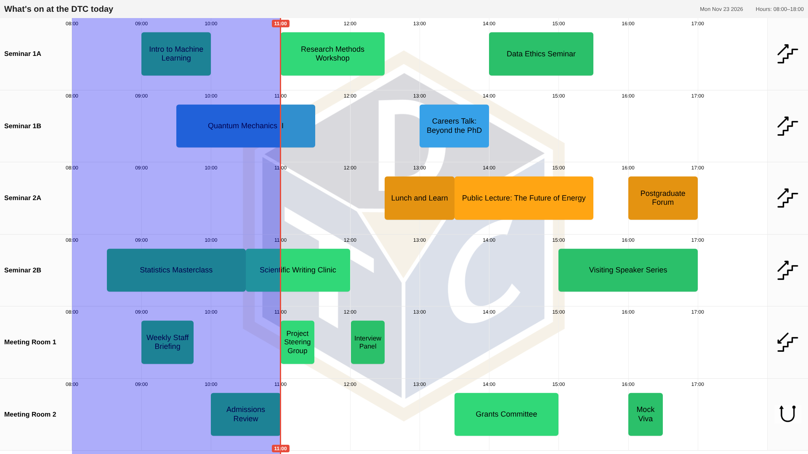

# Calendar Dashboard

**Turn your existing room calendars into a clear, at-a-glance display of what’s happening today.**

Ever had someone ask *“Where’s my meeting?”* or *“Is this room free?”* when the answer is already in a calendar somewhere?

Calendar Dashboard puts that information where people need it: on a reception screen, outside teaching rooms, in a corridor or on any browser-enabled display.  It brings together as few or as many room and resource calendars as you need into one easy-to-read daily timeline, so visitors and colleagues can see **what’s on, where it’s happening and what’s happening right now**.

You don't need to replace your booking system or ask anyone to enter information twice.  Keep managing events in the calendars you already use; the dashboard simply displays them.



## Why use Calendar Dashboard?

- **Help people find the right place, without asking.**  Show today's bookings across multiple rooms on a single screen.  Add direction icons to point people upstairs, downstairs or towards another building.
- **Make the day's schedule obvious.**  A colour-coded timeline shows which rooms are busy, what's coming up next and where there are gaps.  A moving line marks the current time, while earlier hours are gently shaded.
- **Work with calendars you already have.**  Use published calendar links from Microsoft 365 / Outlook, Google Calendar, iCloud, Nextcloud and other services that provide standard `.ics` feeds.  No separate booking system is needed.
- **Keep routine changes in sync.**  Regular weekly events, rescheduled sessions and cancellations are reflected from the source calendars.  There's no second schedule to maintain.
- **Set it up once, then leave it running.**  The display checks for updates automatically and keeps the last successfully loaded information visible if a calendar service temporarily goes offline.
- **Make it look like yours.**  Replace the supplied logos, branding, colours and direction icons with your own.  Choose your organisation's heading, fonts and background images.
- **Display one calendar or many.**  Show a single room or as many calendars as you need, each with its own label and optional direction icon.  The layout can fill a wall-mounted screen or scroll when there are more rooms to show.
- **Run it on modest hardware.**  It's a lightweight Python web app that runs on Linux or Windows, including a Raspberry Pi, and displays in a normal web browser.

## What you can do

### See the whole day at a glance

Choose exactly how many calendars to show, from one meeting room to a whole building.  Each room or resource gets its own row, so it's easy to compare schedules.  Events sit on a timeline rather than in a long list.  Even when bookings overlap, both remain visible and event names adjust to the space available.

### Show people where to go

Replace the supplied direction icons with custom ones that match the signs around your building.  Put an icon beside each room: an upstairs arrow, a downstairs arrow, a building symbol or whatever makes sense for your site.  It's especially handy in receptions, schools, universities and shared buildings.

### Trust the schedule to reflect real life

The dashboard handles repeating bookings as well as one-off events.  If a weekly meeting is moved, an individual session is cancelled, or a booking runs all day, the display can reflect that without you manually editing the wallboard.  You can choose whether all-day events should appear.

### Make the display your own

Make the display look like part of your organisation.  Replace the default logos, branding, colours and direction icons with your own.  Choose the hours, time zone, heading and fonts.  Add your own background logo or rotate through custom images.  Make rows fill the screen or allow scrolling.  You can even turn on **Caturday** to show pet pictures on a chosen day.

### Keep working when a feed has a problem

Calendar Dashboard periodically refreshes the published calendars, avoids unnecessary downloads when possible and retries temporary failures.  If a calendar can't be reached, the last successfully retrieved schedule stays on screen rather than vanishing.  For administrators, a diagnostic view at `/api/events` helps explain what the dashboard is currently showing.

## A simple setup

You only need two plain-text configuration files:

- **`calendars.txt`** lists as few or as many calendar links as you need, with optional room names and custom icons.
- **`preferences.txt`** lets you change the appearance and behaviour.  It's optional: the dashboard works with its defaults if you leave it out.

Save your changes and the dashboard picks them up on its next refresh—no admin panel or application restart needed.  There are no user accounts or database to maintain.

**Ready to try it?**  Follow the quick-start instructions below.  For a permanent display, see [Running it for real](#running-it-for-real).

## Quick start

Linux:

```bash
git clone https://github.com/emalins/calendar_app.git
cd calendar_app
python3 -m venv .venv
source .venv/bin/activate
pip install -r requirements.txt
python app.py
```

Windows (PowerShell):

```powershell
git clone https://github.com/emalins/calendar_app.git
cd calendar_app
py -m venv .venv
.venv\Scripts\Activate.ps1
pip install -r requirements.txt
python app.py
```

A virtual environment (`.venv`) keeps the app's packages separate from the system Python.  Modern Debian, Ubuntu and Raspberry Pi OS require this, and `pip install` into the system Python fails there with `error: externally-managed-environment`.  If `python3 -m venv` itself fails on those systems, install the module first with `sudo apt install python3-venv`.

Remember to activate the environment (the `source` or `Activate.ps1` line) in each new terminal before running the app.  To run it without activating, call the environment's Python directly, e.g.  `.venv/bin/python app.py`.

Open <http://localhost:5000>.  For a wallboard, open that address full screen on the display (for example in a browser's kiosk mode).

`python app.py` serves the dashboard with [Waitress](https://docs.pylonsproject.org/projects/waitress/), a production-quality server, on port 5000.  To have it start automatically on a wallboard, see [Running it for real](#running-it-for-real).

## Configuring your calendars: `calendars.txt`

This file is **required**.  Display just one calendar or add as many as you need.  It must contain at least one calendar, otherwise the dashboard shows "No calendars found".  Put one calendar per line, in the format:

```
Label | Calendar URL | icon
```

```
# Lines starting with # and blank lines are ignored
Seminar 1A   | https://example.org/calendars/seminar-1a.ics  | upstairs.png
Seminar 2A   | https://example.org/calendars/seminar-2a.ics  | upstairs.png
Meeting Room | https://example.org/calendars/meeting-room.ics | downstairs.png
Annexe       | https://example.org/calendars/annexe.ics      | goaround.png
Quiet Room   | https://example.org/calendars/quiet-room.ics
https://example.org/calendars/just-a-url.ics
```

| Part | Required | What it does |
|---|---|---|
| **Label** | No | The room name shown at the left of the row.  If omitted, the URL is shown. |
| **URL** | Yes | The `.ics` feed for that room. |
| **icon** | No | The picture shown at the right of the row.  See below. |

Rows appear in the order listed, and the order also decides each row's colour (see `CALENDAR_COLORS`).

If you don't need a label or icon you can give just the URL, or `Label | URL`.

### Changing the icons

The third field is an image that appears in a column on the right-hand end of that room's row.  Replace the supplied icons with your own artwork to match your building's signage.  It is typically used to show people which way to go, for example an "up" arrow for upstairs lecture theatres, a "down" arrow for the basement, or a "go around" sign for rooms in another building.  It can be any picture you like: a floor number, a building badge or a department logo.

You can supply the icon in any of these forms:

| Value | Meaning |
|---|---|
| `upstairs.png` | A file in the `static/` folder. |
| `icons/lift.png` | A file in a sub-folder of `static/`. |
| `/static/icons/lift.png` | The same, written as a full site path. |
| `https://example.org/lift.png` | An image hosted elsewhere. |

To use your own icons:

1.  Copy your image files into the `static/` folder (or a sub-folder of it).
2.  Put the file name in the third field of the room's line in `calendars.txt`.
3.  Save.  The display picks it up at its next refresh.

Notes:

- The bundled `upstairs.png`, `downstairs.png` and `goaround.png` are examples you can replace or delete.
- Icons are shown at up to about 64 x 56 pixels, scaled down to fit, so simple high-contrast images work best.  PNG with a transparent background looks good.
- If an icon file can't be found, it is quietly left out and the rest of the row displays normally.
- Rooms can share an icon, or have none.

## Configuring the display: `preferences.txt`

Lines look like `KEY=value`.  Lines starting with `#` and blank lines are ignored.

**Every setting is optional, and so is the file itself.**  If `preferences.txt` is missing, or a setting is missing or has an invalid value, the default shown in the tables below is used.  You only need to list the settings you want to change.  Changes are picked up automatically, with no restart.

True/false settings accept `true`, `yes`, `on` or `1` (any capitalisation) for "on".  Anything else counts as "off".

### Date, time and refresh

| Setting | Required | Default | Description |
|---|---|---|---|
| `TIMEZONE` | No | `Europe/London` | Time zone used for the day and for interpreting events (any IANA name, e.g.  `America/New_York`).  Unrecognised names fall back to `Europe/London`. |
| `DISPLAY_DATE` | No | `today` | `today` shows the current day.  Set a fixed date as `YYYY-MM-DD` to show that day instead (useful for testing or for an event day).  An invalid value falls back to today and adds a warning to `/api/events`. |
| `WORK_START_HOUR` | No | `8` | First hour shown on the timeline (0-23). |
| `WORK_END_HOUR` | No | `18` | Last hour shown (0-23).  Must be later than the start, otherwise both revert to the defaults. |
| `REFRESH_INTERVAL_MINUTES` | No | `5` | How often calendars are re-downloaded, and how often the display checks for new data.  Minimum 1. |
| `SHOW_ALL_DAY_EVENTS` | No | `true` | All-day bookings are drawn across the working hours.  Set `false` to hide them. |

### Layout

| Setting | Required | Default | Description |
|---|---|---|---|
| `FIT_TO_WINDOW` | No | `true` | `true` stretches the rows to fill the screen, ideal for a wallboard.  `false` uses a fixed row height and lets the page scroll. |

### Header

| Setting | Required | Default | Description |
|---|---|---|---|
| `HEADER_TEXT` | No | `Calendar Dashboard` | Title shown at the top, e.g.  `What's on today`. |
| `HEADER_FONT_SIZE` | No | `20` | Size in pixels. |
| `HEADER_FONT_FAMILY` | No | `Arial, sans-serif` | Any CSS font-family value. |
| `HEADER_COLOR` | No | `#1a1a1a` | Text colour. |

### Events

| Setting | Required | Default | Description |
|---|---|---|---|
| `EVENT_SHOW_TIMES` | No | `false` | Add the start and end time after each title, e.g.  `Maths lecture (9AM - 10:30AM)`. |
| `EVENT_FONT_SIZE` | No | `12` | Size in pixels. |
| `EVENT_FONT_FAMILY` | No | `Arial, sans-serif` | Any CSS font-family value. |
| `EVENT_FONT_COLOR` | No | `#000000` | Text colour. |
| `CALENDAR_COLORS` | No | *(green)* | Comma-separated colours, one per calendar in the order they appear in `calendars.txt`, e.g.  `#2ecc71,#3498db,#f39c12`.  Accepts `#rgb`, `#rrggbb` or `rrggbb`.  Calendars beyond the end of the list use green.  Back-to-back events in a row alternate between two slightly different shades so they are easy to tell apart. |

### "Now" line and past overlay

| Setting | Required | Default | Description |
|---|---|---|---|
| `NOW_LINE_COLOR` | No | `#e74c3c` | Colour of the live current-time line and its time badges. |
| `NOW_LINE_THICKNESS` | No | `2` | Line width in pixels. |
| `PAST_OVERLAY_COLOR` | No | `#000000` | Colour of the shading over the part of the day that has already passed. |
| `PAST_OVERLAY_OPACITY` | No | `0.12` | Strength of that shading, from `0` (invisible) to `1` (solid). |

### Background logo and images

You can replace the background logo with your own organisation's branding.  Use a single custom image or rotate through a folder of images.

| Setting | Required | Default | Description |
|---|---|---|---|
| `LOGO_PATH` | No | *(none)* | A single image, or a folder of images, shown faintly behind the timeline.  Written like icon paths: relative to `static/` (`logos/mylogo.jpg`) or as `/static/logos/mylogo.jpg`.  Supported types: jpg, jpeg, png, gif, webp, bmp, svg. |
| `ROTATE_IMAGES` | No | `false` | If `LOGO_PATH` is a folder, cycle through its images (with a cross-fade).  When off, the first image in the folder (alphabetically) is used. |
| `ROTATE_LOGO_TIME_MINUTES` | No | `60` | How long each image stays up in sequential mode.  Minimum 1. |
| `ROTATE_LOGO_ORDER` | No | `sequential` | `sequential` steps through the folder in name order on a timer, so several screens stay in step.  `random` picks a random image each time the display refreshes. |

### Caturday

Swap the background for a folder of pet pictures on a day of your choice.

| Setting | Required | Default | Description |
|---|---|---|---|
| `CATURDAY` | No | `false` | Turn the feature on. |
| `CATURDAY_DAY` | No | `Friday` | Day of the week it applies, written as a day name (`Monday`...`Sunday`). |
| `CATURDAY_PATH` | No | `/static/caturday` | Folder (or single image) to use on that day.  The rotation settings above apply to it too. |

### Diagnostics

| Setting | Required | Default | Description |
|---|---|---|---|
| `VERBOSE_STARTUP` | No | `false` | Print a summary of the active configuration, including which images were found, when the app starts. |

### Example `preferences.txt`

```ini
WORK_START_HOUR=08
WORK_END_HOUR=18
FIT_TO_WINDOW=true

HEADER_TEXT=What's on today
HEADER_FONT_SIZE=24

EVENT_FONT_SIZE=18
EVENT_SHOW_TIMES=false
CALENDAR_COLORS=#2ecc71,#3498db,#f39c12

REFRESH_INTERVAL_MINUTES=5

NOW_LINE_COLOR=#e74c3c
NOW_LINE_THICKNESS=3

LOGO_PATH=/static/logos/my-logo.jpg
ROTATE_IMAGES=false
```

## Running it for real

`python app.py` already runs the app under [Waitress](https://docs.pylonsproject.org/projects/waitress/), a production-quality WSGI server that is pure Python and behaves the same on Linux and Windows.  By default it listens on port 5000 on **this machine only** (`127.0.0.1`), which is what you want when the browser runs on the same computer, as on a kiosk.  Other devices cannot connect.

To let other devices on your network view the dashboard, set these environment variables before starting it:

| Variable | Default | Description |
|---|---|---|
| `CALENDAR_DASHBOARD_HOST` | `127.0.0.1` | Address to listen on.  Use `0.0.0.0` to accept connections from the network. |
| `CALENDAR_DASHBOARD_PORT` | `5000` | Port to listen on. |

```bash
CALENDAR_DASHBOARD_HOST=0.0.0.0 .venv/bin/python app.py
```

The dashboard has no login.  If you open it up to the network, use your firewall to restrict which machines can reach the port and never expose it to the internet.

Keep it to a single server process (threads are fine): the app keeps its calendar cache and refresh thread in memory.

To start it automatically, either run it from your kiosk or login startup script, or run it as a systemd service on Linux or a Windows Service (for example with [NSSM](https://nssm.cc/)).  In every case, call the virtual environment's Python directly (`.venv/bin/python app.py` or `.venv\Scripts\python.exe app.py`) so it finds the installed packages.  There is no need to activate the environment first.

By default the app reads `calendars.txt` and `preferences.txt` from its own folder.  To keep your configuration somewhere else, set the `CALENDAR_DASHBOARD_CONFIG_DIR` environment variable to that folder.

## Troubleshooting

- **See what the app sees:** open <http://localhost:5000/api/events>.  It shows every calendar's status (`ok`, `stale` or `error`), the events found for the day, and the settings in force.
- **A room shows an error:** check the feed URL opens in a browser.  If a feed temporarily fails, the dashboard keeps showing the last good data and marks that calendar as `stale`.
- **A setting seems ignored:** run with `VERBOSE_STARTUP=true` to see the active configuration at start-up and check for typos in the setting name.

## Known limitations

- There is no login.  Anyone who can reach the page can see it, so only show calendars you are happy to display publicly and note that `/api/events` includes the feed URLs.
